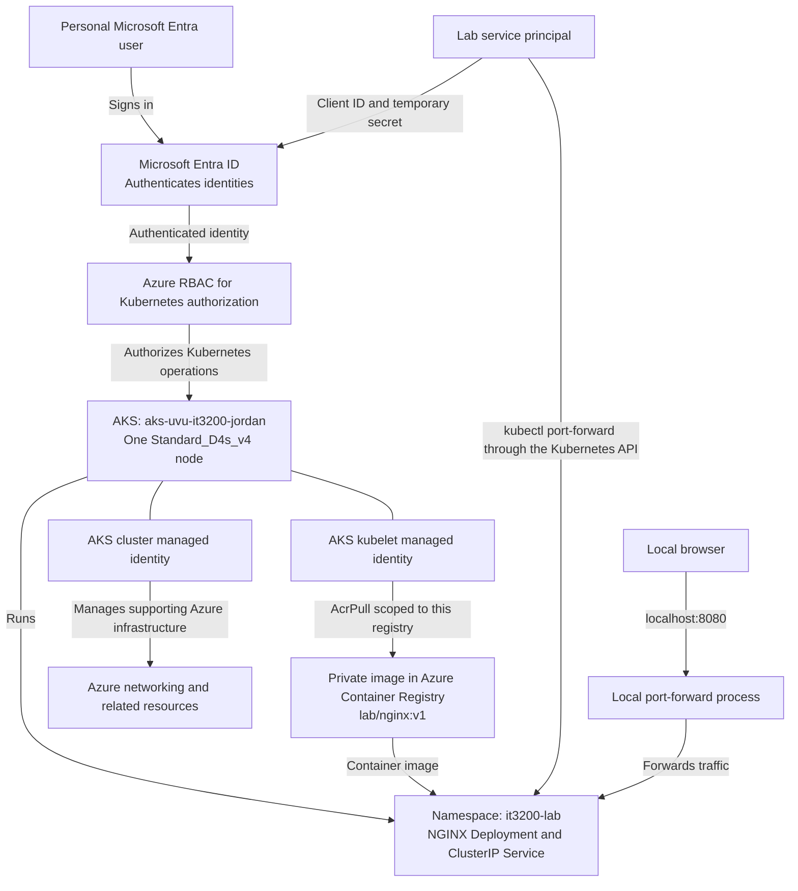

# Architecture and Identity Design

This lab deploys an Entra-integrated AKS cluster and an authenticated
Azure Container Registry in West US 3 using Terraform.

## Architecture Diagram

## Identity and Permission Assignments

| Identity | Permission | Scope | Purpose |
|---|---|---|---|
| Service principal | Azure Kubernetes Service Cluster User Role | AKS cluster | Retrieve user kubeconfig |
| Service principal | Azure Kubernetes Service RBAC Reader | AKS cluster | Read supported Kubernetes resources |
| Service principal | Azure Kubernetes Service RBAC Writer | `it3200-lab` namespace | Deploy and manage the lab workload |
| Personal user | Azure Kubernetes Service RBAC Reader | AKS cluster | Inspect Kubernetes resources for comparison and troubleshooting |
| Kubelet managed identity | AcrPull | ACR registry | Pull the application image |

The personal account also used its existing Azure permissions to provision
resources and assign roles. These Azure management permissions are separate
from Kubernetes resource authorization.

The AKS cluster managed identity manages supporting Azure infrastructure.
It is distinct from the kubelet identity used for registry image pulls.

## Temporary Namespace Permission

A custom role temporarily granted the personal user namespace read/write
permissions at the lab cluster scope. It was used to create `it3200-lab`.

After namespace creation, the temporary role assignment and custom role
definition were removed through Terraform.

## Security Decisions

- AKS uses Microsoft Entra authentication and Azure RBAC authorization.
- Local AKS accounts are disabled.
- The ACR administrator account is disabled.
- Deployment access is restricted to `it3200-lab`.
- The service principal cannot deploy in `default` or delete namespaces.
- Reader access does not grant core node reads or access to Secrets.
- Namespace Writer includes access to Secrets within its namespace.
- The service principal secret has a short, explicitly configured expiration.
- Terraform state, local variables, credentials, and saved plans are excluded
  from Git.
- The Deployment references an image digest to identify the exact image.
- ACR uses an authenticated public endpoint; no private endpoint was configured.

## Lab Limitations

The cluster has one node and is not highly available. It was successfully
deployed for this lab, despite the ambiguity encountered in published
system-pool sizing guidance.

AKS uses the Free control-plane tier. Worker nodes, disks, networking,
and the registry can still generate charges.

The application uses a ClusterIP Service and local port forwarding.
No public application load balancer was created.